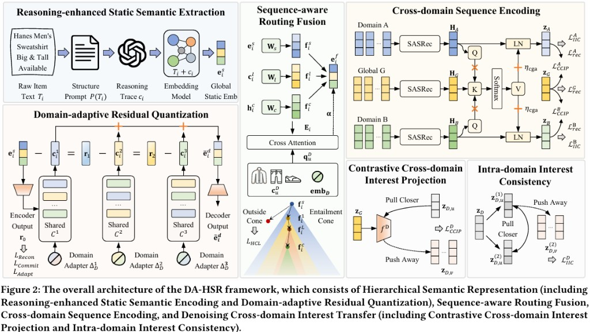
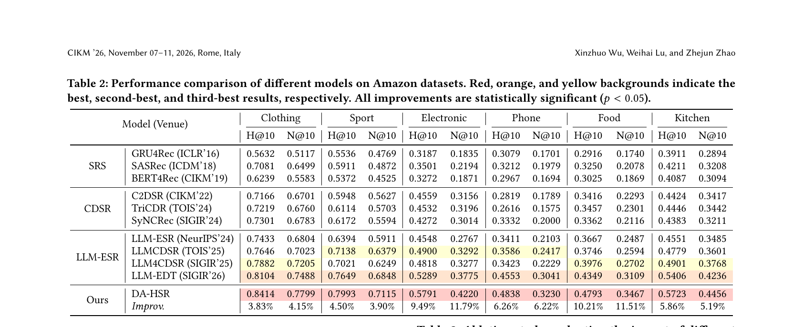

# DA-HSR

Official implementation of **Bridging the Domain Gap: Domain-Aware Hierarchical Semantic Representation for Cross-Domain Sequential Recommendation** (CIKM 2026).

DA-HSR learns transferable yet domain-sensitive item representations for cross-domain sequential recommendation. Shared residual codebooks capture global semantics, while low-rank domain adapters recover local interpretations. A sequence-conditioned router then selects the relevant granularity, and guided attention with contrastive denoising transfers cross-domain interest without relying on overlapping users.

<p align="center">
  
</p>

## Requirements

```bash
conda create -n dahsr python=3.9 -y
conda activate dahsr
pip install -r requirements.txt
```

Stage-1 DRQ training additionally uses `k-means-constrained` (already listed in `requirements.txt`). GPU with CUDA is recommended.

## Data Preparation

Experiments use three Amazon pairs: Clothing-Sport (`cloth`), Electronics-Phone (`elec`), and Food-Kitchen (`food`). Place the raw review and metadata files under `data/{cloth,elec,food}/raw/`.

```bash
# Clothing-Sport
wget -c https://mcauleylab.ucsd.edu/public_datasets/data/amazon_v2/categoryFiles/Clothing_Shoes_and_Jewelry.json.gz
wget -c https://mcauleylab.ucsd.edu/public_datasets/data/amazon_v2/metaFiles2/meta_Clothing_Shoes_and_Jewelry.json.gz
wget -c https://mcauleylab.ucsd.edu/public_datasets/data/amazon_v2/categoryFiles/Sports_and_Outdoors.json.gz
wget -c https://mcauleylab.ucsd.edu/public_datasets/data/amazon_v2/metaFiles2/meta_Sports_and_Outdoors.json.gz
```

Electronics-Phone and Food-Kitchen follow the same layout; download URLs are listed in `experiments/handle.sh`. Users and items with fewer than 5 interactions are filtered in each domain. Evaluation uses leave-one-out splitting and sampled ranking with 99 negatives.

```bash
bash experiments/handle.sh
```

If Sports metadata is missing `B001ARYU58`, add the corresponding entry to `data/cloth/handled/item2attributes_B.json` before embedding generation.

## Two-Stage Training

### 1. Reasoning-enhanced static semantics

Generate item-level reasoning traces with Qwen3-Max (or a compatible API) and encode `[item text; reasoning]` with Qwen3-Embedding-0.6B.

```bash
export API_KEY="YOUR_KEY"
python data/generate_emb.py --dataset cloth --api_key "$API_KEY"
```

Without an API key, the script encodes raw item text only.

### 2. Domain-adaptive Residual Quantization (Stage 1)

Pre-train DRQ with $L=3$ codebooks of size $K=256$, MMD reconstruction, commitment loss $\lambda_{\mathrm{com}}=0.1$, and adapter regularization $\lambda_{\mathrm{adapt}}=10^{-4}$.

```bash
bash experiments/train_sid_cloth.sh
bash experiments/gen_sid_cloth.sh
```

This writes layer-wise codes to `data/cloth/handled/drq_layer_embs.pkl`.

### 3. Full DA-HSR training (Stage 2)

Default hyperparameters match the paper: embedding size $d=128$, learning rate $10^{-4}$, batch size 256, maximum length 50, $\alpha=0.5$, $\beta=0.1$, $\gamma=0.05$, $\tau_1=\tau_2=0.1$.

```bash
bash experiments/train_model_cloth.sh
```

Replace `cloth` with `elec` or `food` for the other domain pairs.

## Experimental Results

DA-HSR is compared with single-domain sequential models, CDSR methods, and LLM-enhanced sequential recommenders on HR@10 and NDCG@10.

<p align="center">
  
</p>

## Repository Structure

```text
DA-HSR/
├── models/            # DA-HSR, routing, CGA, hyperbolic HCL, SASRec
├── RQ-VAE/            # Stage-1 Domain-adaptive Residual Quantization
├── trainers/          # training and evaluation
├── generators/        # CDSR sequence datasets
├── data/              # preprocessing and embedding scripts
├── experiments/       # reproduction scripts
└── assets/            # framework and result figures
```

## Citation

```bibtex
@inproceedings{wu2026dahsr,
  title     = {Bridging the Domain Gap: Domain-Aware Hierarchical Semantic Representation for Cross-Domain Sequential Recommendation},
  author    = {Wu, Xinzhuo and Lu, Weihai and Zhao, Zhejun},
  booktitle = {Proceedings of the 35th ACM International Conference on Information and Knowledge Management},
  year      = {2026}
}
```
